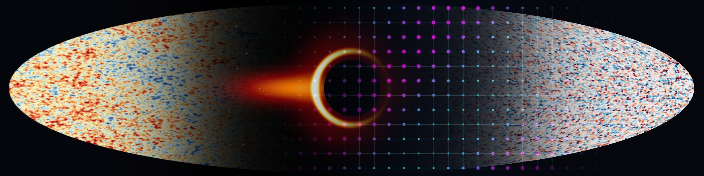

<p align="center"><a href="https://hmahaffeyges.github.io/IAM-Validation/"></a></p>

# IAM's Law and Order

**The Actualization of Reality** — *The Cost of Recording It, and the Price of Maintaining It.*

**One law of physics from the qubit to the genome to the cosmic horizon.**

<p align="center">
  <a href="https://hmahaffeyges.github.io/IAM-Validation/"></a>
  <a href="https://hmahaffeyges.github.io/IAM-Validation/read/"></a>
  <a href="https://hmahaffeyges.github.io/IAM-Validation/pdf/IAMs_Law_and_Order.pdf"></a>
  <a href="https://hmahaffeyges.github.io/IAM-Validation/epub/IAMs_Law_and_Order.epub"></a>
  <a href="https://github.com/hmahaffeyges/IAM-Validation/releases/download/v1.0.0/IAMs_Law_and_Order_LaTeX_source_v1.0.0.zip"></a>
  <a href="https://hmahaffeyges.github.io/IAM-Validation/read/"></a>
</p>

Heath W. Mahaffey, IAMPerformance (independent research).

**Cite the book (version 1.0, October 2026):** Mahaffey, H. W. *IAM's Law and Order: The Actualization of Reality.* Zenodo. [https://doi.org/10.5281/zenodo.23151068](https://doi.org/10.5281/zenodo.23151068)

[](https://doi.org/10.5281/zenodo.23151068) [](https://doi.org/10.17605/OSF.IO/KCZD9) [](https://doi.org/10.5281/zenodo.18702042) [](https://opensource.org/licenses/MIT)

<!-- NOW_RUNNING:BEGIN (generated by CANON/now_running.py from CANON/now_running.json; do not edit by hand) -->

## Now running

*Live experiments, in plain words. Each update links to its record. Results are posted here win or lose.*

### Building a bigger map of healthy cells: IAM-Atlas v2.1

**Running now.** Every IAM reading compares a sample with healthy cells. The atlas is that comparison: a map of what 74 kinds of healthy human cells look like. Version 2.1 more than doubles the samples behind it and adds second and third laboratories for key cells, so the map stops depending on any one lab's habits.

- **What we hope:** The new laboratories agree with the old ones, the map gets steadier, and tests that were too close to call, like lung, get a fair chance.
- **What could go wrong:** Cells grown in a dish may have drifted too far to use; a new laboratory may disagree with the old ones; the fit may need more computing time than planned.

| date | update |
|---|---|
| 2026-10-12 | Culture check, second and third laboratories: much of the dish effect shows up again, in different cells grown in different labs. [record](Biological_Physics/MethylPhys/doors/DEV_ATLAS_V21_01.md) |
| 2026-10-12 | Culture check, first result: growing cells in a dish changes them a lot. In the cleanest comparison, about 1 in 9 of the sites we read moves steadily as the cells keep dividing. Those sites will be set aside before any dish-grown cell is compared with the atlas. Two more laboratories' data are next. [record](Biological_Physics/MethylPhys/doors/DEV_ATLAS_V21_01.md) |
| 2026-10-12 | First step running: measuring how much growing cells in a dish changes them. [record](Biological_Physics/MethylPhys/doors/DEV_ATLAS_V21_01.md) |

*The full story so far, every update in plain words: [field notes](FIELD_NOTES.md#atlas-v21).*

### Does our second instrument read the same DNA the same way everywhere?

**Running now.** Before anyone trusts an instrument, it has to give the same answer on the same sample. We read identical reference DNA prepared with five different kits in two laboratories.

- **What we hope:** The one check that failed turns out to come from how we sampled three very large files, not from the laboratories.
- **What could go wrong:** If the difference is real, that kit's lab-to-lab check stays failed and the record says so.

| date | update |
|---|---|
| 2026-10-12 | The cause test is running on a rented computer: the three low files and two normal ones, each read from its start, middle and end. [record](Biological_Physics/MethylPhys/doors/DEV_IAMA_CAUSE_01.md) |
| 2026-10-12 | The cause test is written and listed in the run ledger. It starts when rented-computer prices and availability allow. [record](Biological_Physics/MethylPhys/doors/DEV_IAMA_CAUSE_01.md) |
| 2026-10-12 | Four of five checks passed: repeats agree, kits agree, and a planted change was seen every time. The lab-to-lab check failed on three files, so by our own rule nothing is declared until the cause is found. [record](Biological_Physics/MethylPhys/doors/DEV_IAMA_COMMISSION_01_OUTCOME.md) |

*The full story so far, every update in plain words: [field notes](FIELD_NOTES.md#iama-commission).*

### Brain cells: does healthy order hold in cells that never divide?

**Getting ready.** Neurons stop dividing for life, so they can never refresh their switch pattern by making a new copy. If they still sit where physics says healthy cells should, that tells us how cells hold their information. We built a healthy brain-cell reference from one laboratory's neurons, using a rule written before we looked.

- **What we hope:** Healthy neurons from two other laboratories, which we have never opened, read inside the healthy range we set in advance.
- **What could go wrong:** How the cells were prepared moved our first readings more than age or brain region did, so the reference may first need a rule about preparation before the test is fair.

| date | update |
|---|---|
| 2026-10-12 | Healthy brain-cell reference built by its rule, from seven samples of five donors. Cleanly sorted cells read tightly together; unsorted cells read higher. [record](Biological_Physics/MethylPhys/doors/DEV_IAMA_NEURON_01.md) |

*The full story so far, every update in plain words: [field notes](FIELD_NOTES.md#neurons).*

### Lung cancer: waiting for a better map of the lung

**On hold.** We compare each patient's tumor with the same patient's normal lung. Before any tumor is opened, made-up tests on normal lungs must show that ordinary differences between people's lungs cannot fake a cancer signal.

- **What we hope:** With dish-grown lung support cells checked and added to the atlas, the made-up tests pass and the real tumors can finally be read.
- **What could go wrong:** The dish may have changed those cells too much to use, in which case lung waits for fresh, undish-grown samples that nobody has made public yet.

| date | update |
|---|---|
| 2026-10-12 | Four lung sets tried: one read with no clear cancer signal; three stopped by their made-up tests before any tumor was opened, so none was wasted. [record](Biological_Physics/MethylPhys/doors/DEV_TISSUE_LUNG_04.md) |

*The full story so far, every update in plain words: [field notes](FIELD_NOTES.md#lung).*

<!-- NOW_RUNNING:END -->

## IAM's Law

Every irreversible transition pays a thermodynamic cost at the nearest encoding surface: `k_B T ln 2` per bit, at that surface's own
temperature. The cost cannot be recovered or engineered away. Different substrates expose it differently; the law is the same.
The cost is Landauer's and has been measured; the surface and its temperature are Bekenstein's and Hawking's; Jacobson showed that
gravity follows from the thermodynamics of such surfaces.

## What IAM is

The Informational Actualization Model is a testable set of equations inside general relativity, the piece Jacobson's thermodynamic
derivation of Einstein's equations left open. At the cosmic horizon it fixes a late-time coupling with no free parameter: IAM fits the
Planck CMB as well as ΛCDM and predicts slower growth of structure with lensing unchanged, a test Euclid and DESI will make. In the
cell, the same price per bit sets a floor under how faithfully a methylation pattern can be held, and two instruments read each
cell's informational fidelity against that floor and against its own healthy state. The substrate changes. The noise changes. The measured inputs
change. The thermodynamic accounting does not.

## Try to break it

`python3 docs/book/verify_book.py` checks every derivation and calculated number in the book. Found something wrong? Open an issue
with the "I tried to break it" template ([`CONTRIBUTING.md`](CONTRIBUTING.md)).

## Why pick it up

- **For a cosmologist:** one parameter-free line fixes `μ_0`, the `fσ_8` ramp, `Σ = 1`, `E_G`, `S_8` and the two Hubble rates together, and
  the full Planck likelihood with the coupling fixed fits as well as ΛCDM. The surveys now running measure its size.
- **For a quantum physicist:** a gate error and a quasiparticle density have a thermal floor at the device's own temperature, from
  `k_B T ln 2` alone. The book gives the physics, with makers' published device values as illustrations.
- **For a geneticist:** the methylation pattern is a record a cell pays to keep. Each cell type is read against its own healthy state,
  so one person can be measured, measured again, and compared with themselves.

Every claim carries one status label (DERIVED, CALCULATED, CALIBRATED, MEASURED, OBSERVED, FITTED, CONJECTURE, PREDICTION or OPEN), and
every number in the book is recomputed by a script in this repository. The invitation is to try to break it.

## The atlas

**IAM-Atlas v2** is the reference every instrument reads against: 74 purified healthy human cell types, every CpG with its value and a
measured uncertainty, from arrays and sequencing of several laboratories fitted as one model and fixed before any sample is read.
It was built for IAM's measurement and is independent of IAM's physics: the atlas supplies the healthy end of the gauge and IAM's Law the floor,
so a reading that lands where the law predicts is evidence, not a reflection of the reference.
What it is, how it was built, how to get it and what it has passed: [`Biological_Physics/MethylPhys/atlas/`](Biological_Physics/MethylPhys/atlas/); the fitted atlas: DOI [10.5281/zenodo.23325865](https://doi.org/10.5281/zenodo.23325865).

## Support this work

<!-- FUNDING:BEGIN (generated by CANON/funding_sync.py from CANON/funding.json; do not edit by hand) -->
This research is independent, with no institutional or company funding. We fund it ourselves, together with people who choose to help. Every dollar spent on rented computing is listed, run by run, in the public [run ledger](Biological_Physics/MethylPhys/RUNS.md).

To help: **[Help fund early cancer detection research, built in public](https://www.gofundme.com/f/help-fund-early-cancer-detection-research-built-in-public)** (GoFundMe). To follow the work: [FOLLOW.md](FOLLOW.md). The live front page of all of this, with the experiments now running, the results and the costs: <https://hmahaffeyges.github.io/IAM-Validation/>.
<!-- FUNDING:END -->

## Start here

| what | where |
|---|---|
| **The book**, *IAM's Law and Order* (seven parts, LaTeX, compiles as-is in Overleaf) | [`docs/book/`](docs/book/) — open `main.tex` |
| Corrections to every source paper (authoritative where a paper and this list disagree) | [`docs/verification/PAPER_ERRATA.md`](docs/verification/PAPER_ERRATA.md) |
| Every constant and name, defined once | [`CANON/GLOSSARY.md`](CANON/GLOSSARY.md) (generated from `CANON/iam_canon.json`; `python3 CANON/canon_check.py`) |
| Every prediction, with its test and status | the book's predictions chapter and register appendix; source list [`CANON/predictions_register.csv`](CANON/predictions_register.csv) |
| Recomputation scripts for the book's numbers | [`docs/verification/scripts/`](docs/verification/scripts/) |
| Check every derivation in the book | [`docs/book/verify_book.py`](docs/book/verify_book.py): `python3 docs/book/verify_book.py` (results and inventory in [`docs/book/verification/`](docs/book/verification/)) |
| Cosmology and gravitation | [`Cosmological_Physics/`](Cosmological_Physics/) — Level 1 and Level 2 chains, data, early tests |
| Cellular physics | [`Biological_Physics/`](Biological_Physics/) — the cell instrument (chain v3, in development): SOP, operations manual, toolkit |
| Quantum and particle physics | [`Quantum_and_Particle_Physics/`](Quantum_and_Particle_Physics/) — the scripts behind Parts IV and V |
| Development logs | [`development/`](development/) — every development finding, one running log per project |

## Results, with their status

| place | result | status |
|---|---|---|
| cosmic horizon | matter-sector coupling `β_m = Ω_m/2 = 0.15765`, so `μ(0) = 0.864` (`μ_0 = −0.136`), `Σ = 1` | DERIVED (from the partition), CALCULATED |
| cosmic horizon | Planck 2018 fit with the coupling fixed: `Δχ² = +0.54` against ΛCDM; `σ_8` 0.8087 → 0.7998 | MEASURED (chains) |
| cosmic horizon | `fσ_8` 4.25 % below ΛCDM today, 2.17 % at z = 0.3, 0.41 % at z = 1; lensing unchanged | CALCULATED; PREDICTION |
| cosmic horizon | two Hubble rates: 67.16 (light) and 72.26 = 67.161·√1.1575 km/s/Mpc (matter flow) | CALCULATED; PREDICTION |
| cosmic horizon | putting the term in the background instead moves `H_0` to 61.5 (10.9σ): the background does not change in IAM | MEASURED (chains) |
| surveys | growth surveys through the mid-2030s reach about 2.5–3σ on the deficit with the CMB fixing the early amplitude; DESI DR2 full shape is next | CALCULATED (Fisher forecast) |
| black holes | horizon bits priced at the horizon's temperature total `½Mc²` (Smarr) | DERIVED |
| qubits | thermal floor of a transmon gate at its own temperature, from `k_B T ln 2` | DERIVED, CALCULATED |
| chips | Ryzen 9 9950X switches at 576–593 × `k_B T_j ln 2` (published TDP, clock and transistor count) | CALCULATED |
| cells | neutrophils read against their own healthy reference: held out, spread 0.020 around 1 | CALIBRATED, MEASURED |
| cells | reference atlas v2: 74 purified healthy cell types built as one Bayesian posterior (NUTS, about 814,000 loci) across seven public sources on arrays and sequencing, with an interval at every locus for every cell; held-out values fall inside the stated 90 % interval 92.7 % of the time. To our knowledge, the first cell-type methylation reference built this way | MEASURED |
| cells | cancer fingerprints (prostate in two laboratories, breast lines, breast and colorectal patients), a physics prediction met in mice, three-laboratory agreement, Met-A commissioned on neutrophils | dated, each with its record, in the table below |

### Cells: results by date

Each was tested by a rule written down and sealed before its data were read, and scored once. Development results are not yet commissioned.

<!-- CELL_RESULTS:BEGIN (generated by CANON/results_to_tex.py from CANON/results_register.json; do not edit by hand) -->
| date | result | status | record |
|---|---|---|---|
| 2026-10-12 | **Met-A on patients' liver tumors.** Each of 50 TCGA tumors read against the same patient's normal liver on the same plate, at sites the tissue mix cannot move, by a rule sealed before any tumor array was downloaded: 22 of 50 above the healthy bar (8 needed; p = 5.4e-16); 44 of 50 above their own normal. Group-level; TCGA built the reading | MEASURED, sealed before reading; development | [record](Biological_Physics/MethylPhys/doors/DEV_TISSUE_LIVER_01_OUTCOME.md) |
| 2026-10-11 | **Met-A on patients' breast tumors.** Each of 53 TCGA tumors read against the same patient's normal tissue at sites the tissue mix cannot move, by a rule sealed before any tumor array was downloaded: 23 of 53 above the healthy bar (6 needed; p = 1.7e-16); 41 of 53 above their own normal. Group-level; TCGA built the reading | MEASURED, sealed before reading; development | [record](Biological_Physics/MethylPhys/doors/DEV_TISSUE_BREAST_01_OUTCOME.md) |
| 2026-10-11 | **Met-A on patients' colorectal tumors.** Each of 88 tumors read against the same patient's adjacent normal colon on the same slide, at sites the tissue mix cannot move, by a rule sealed before any tumor array was read: 28 of 88 above the healthy bar (11 needed; p = 1.4e-15); 80 of 88 above their own normal. Group-level; one laboratory | MEASURED, sealed before reading; development | [record](Biological_Physics/MethylPhys/doors/DEV_TISSUE_COLON_01_OUTCOME.md) |
| 2026-10-11 | **Cancer fingerprint replicated: prostate, a second laboratory, different cells.** ENCODE (HudsonAlpha): LNCaP clone FGC against its own normal prostate epithelial cells: methylation lost in runs in 6 of 6 cancer files, the smallest 2.31 times the healthy donor-to-donor excess; Met-A also above the copy-error line (z 3.09). Same verdict as the first laboratory, by the rule sealed before reading | MEASURED, sealed before reading; development | [record](Biological_Physics/MethylPhys/doors/DEV_FINGERPRINT_02_OUTCOME.md) |
| 2026-10-11 | **Cancer fingerprint in breast cancer cell lines.** MCF-7 and T47D, each against two kinds of normal breast cells (4 pairs, ENCODE), sealed one pair at a time: the gain meter (methylation added where it should not be) reads a fingerprint in 4 of 4; the loss meter in 3 of 4, with 1 undecided | MEASURED, sealed before reading; development | [record](Biological_Physics/MethylPhys/doors/DEV_FINGERPRINT_02_OUTCOME.md) |
| 2026-10-10 | **Cancer fingerprint, both instruments on the same cells.** Prostate cancer (LNCaP) against normal prostate epithelium: methylation lost in runs on every cancer run (0.110–0.113 vs at most 0.0043 in normal), and Met-A 1.226 above the line copy error allows (1.167); fingerprint by the rule sealed before reading. One line, one laboratory | MEASURED, sealed before reading; development | [record](Biological_Physics/MethylPhys/doors/DEV_FINGERPRINT_01_OUTCOME.md) |
| 2026-10-10 | **IAM-A, first physics lever.** Cutting the liver's methyl supply (Mat1a knockout mice) raises copy error by the amount IAM's Law predicts: window 1.016–1.135 sealed on a healthy mouse, knockout read 1.124 against 8 healthy mice (p = 0.0003); restoring SAMe moves it back (1.098). The knockout livers also carry steatohepatitis, a second route not yet separated | PREDICTION met (sealed); development | [record](Biological_Physics/MethylPhys/doors/DEV_SAM_LEVER_01_OUTCOME.md) |
| 2026-10-10 | **Met-A reproduces across laboratories.** Identical DNA (7 reference cell lines, SEQC2 EpiQC) reads the same at three laboratories within 0.8 % before any tare; technical repeats within 0.0114 | MEASURED, sealed before reading; development | [record](Biological_Physics/MethylPhys/doors/DEV_EPIQC_ARRAY_01_OUTCOME.md) |
| 2026-10-10 | **Met-A raises no false alarm** when 4–15 % liver, lung, colon or neuron DNA is mixed into blood DNA (9 of 9 within the sealed bar; largest shift 0.0094) | MEASURED, sealed before reading; development | [record](Biological_Physics/MethylPhys/doors/DEV_CSCORE_MOSS_01_OUTCOME.md) |
| 2026-10-10 | **Everything the commissioned chain reads rebuilds from public data**, identical: the holding energy 3.41 k_BT and ε₀ = 0.032 (153 public samples), the Met-A floor and its 6,000 sites, the C-score baseline, whole-blood composition, the IAM-A neutrophil position | COMMISSIONED | [record](Biological_Physics/MethylPhys/doors/PROC_CHANNEL_01_OUTCOME.md) |
| 2026-10-09 | **Met-A on isolated neutrophils (EPIC v1) commissioned**, with its detection limit printed on every report | COMMISSIONED | [record](Biological_Physics/MethylPhys/doors/COMMISSIONING_NOTE_METAA_NEUTROPHILS.md) |
<!-- CELL_RESULTS:END -->

The cell instrument is being commissioned stage by stage: base chain first, then atlas deconvolution, NILC, per-cell readings,
directional decomposition and the sky tools. Each stage enters the chain only after its own check passes; the order and status are in the
SOP, section 2b.

## The papers

The book is the one current text. The papers it was built from were written and shared along the way; they are not kept in this
repository, because the book corrects and supersedes them. Every correction, with the original passage beside the corrected one, is in
[`docs/verification/PAPER_ERRATA.md`](docs/verification/PAPER_ERRATA.md). The originals remain public on
[OSF](https://doi.org/10.17605/OSF.IO/KCZD9) and [Zenodo](https://doi.org/10.5281/zenodo.18702042).

## Reproduce

**Check the book's derivations in one command:** `python3 docs/book/verify_book.py`. Every derivation and calculated number in the book is checked and passes (4,691 checks, 0 failures), in the book's order, each with its equation label (`--part N`, `--label L`, `--fails`, `--json`).

**Development logs:** every development finding, good or bad, is logged as it happens in [`development/`](development/), one running log per project (Met-A, IAM-A and C-scores; wild versus hatchery fish). The book carries results once the chain that produced them is commissioned.


```
git clone https://github.com/hmahaffeyges/IAM-Validation && cd IAM-Validation
pip install numpy scipy pandas matplotlib
python3 CANON/canon_check.py                                   # constants and names consistent
python3 docs/verification/scripts/verify_encoding_ladder.py    # the encoding surfaces; see the Saturation appendix's identity table
```
The cell chain is run as in [`Biological_Physics/MethylPhys/README.md`](Biological_Physics/MethylPhys/README.md) and its operations manual;
`python3 Biological_Physics/MethylPhys/kit/release_check.py` checks it end to end. The book compiles with `pdflatex`/`bibtex` (or Overleaf)
from [`docs/book/main.tex`](docs/book/main.tex).

## Citation

```bibtex
@misc{Mahaffey2026,
  author    = {Mahaffey, Heath W.},
  title     = {Dual-Sector Cosmology from Structure-Driven Expansion: The Informational Actualization Model},
  year      = {2026},
  publisher = {Zenodo},
  doi       = {10.5281/zenodo.18702042},
  url       = {https://doi.org/10.5281/zenodo.18702042}
}
```

## Contact

Heath W. Mahaffey, IAMPerformance (independent research). Email: hmahaffeyges@gmail.com. GitHub: [@hmahaffeyges](https://github.com/hmahaffeyges).
Questions, checks and replications are welcome as GitHub issues.

## License

MIT. See [LICENSE](LICENSE).

## Acknowledgements

The work rests on Landauer, Bennett, Bekenstein, Hawking, Gibbons, Jacobson, Cai and Kim, and Zurek. Data: the Planck, SDSS/BOSS/eBOSS,
SH0ES, Pantheon+, DESI, KiDS and DES collaborations, and the authors of every public methylation data set read here (named in each
record). Software: CAMB (Lewis, Challinor), MGCAMB (Wang, Mirpoorian, Pogosian, Silvestri, Zhao), Cobaya (Torrado, Lewis), HEALPix, NumPy,
SciPy, Matplotlib, GetDist.

---

*I den frie forskers tradition — i taknemmelighed for dem, der gik forud.*  
*In the tradition of the independent researcher — in gratitude to those who came before.*

Heath W. Mahaffey, IAMPerformance (independent research). He lived and studied in Denmark and the Faroe Islands, where independent
research (*fri forskning*) is an old and respected tradition; the work is offered in that spirit. Collaborators are welcome: see
[`CONTRIBUTING.md`](CONTRIBUTING.md).
