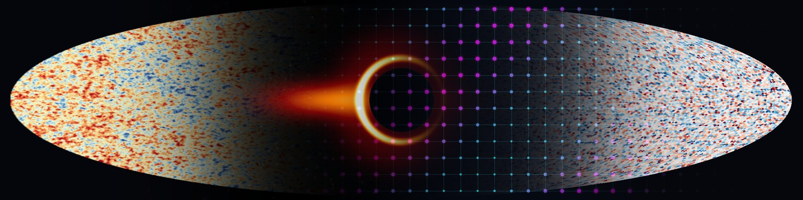

<p align="center"><a href="https://hmahaffeyges.github.io/IAM-Validation/"></a></p>

# IAM's Law and Order

**The Actualization of Reality** — *The Cost of Recording It, and the Price of Maintaining It.*

**One law of physics from the qubit to the genome to the cosmic horizon.**

**For researchers:** [the researcher package](Biological_Physics/MethylPhys/RESEARCHER_PACKAGE.md): read the reports, run the commissioned chain on your own samples, and rebuild every headline result from public data with one command. The hard questions first: [Biological_Physics/MethylPhys/QUESTIONS_AND_ANSWERS.md](Biological_Physics/MethylPhys/QUESTIONS_AND_ANSWERS.md).

IAM is a model of how reality begins with a bit and the cost that comes with it: how information and entropy keep their balance, the thermodynamics of informational fidelity. It is not a new theory of gravity; it reads reality, from the quantum to the classical, through the bit and its price.

<p align="center">
  <a href="https://hmahaffeyges.github.io/IAM-Validation/"></a>
  <a href="https://hmahaffeyges.github.io/IAM-Validation/read/"></a>
  <a href="https://hmahaffeyges.github.io/IAM-Validation/pdf/IAMs_Law_and_Order.pdf"></a>
  <a href="https://hmahaffeyges.github.io/IAM-Validation/epub/IAMs_Law_and_Order.epub"></a>
  <a href="https://github.com/hmahaffeyges/IAM-Validation/releases/download/v1.0.0/IAMs_Law_and_Order_LaTeX_source_v1.0.0.zip"></a>
  <a href="https://hmahaffeyges.github.io/IAM-Validation/read/"></a>
</p>

Heath W. Mahaffey, IAMPerformance (independent research).

**Cite the book (version 1.0, October 2026):** Mahaffey, H. W. *IAM's Law and Order: The Actualization of Reality.* Zenodo. [https://doi.org/10.5281/zenodo.23151068](https://doi.org/10.5281/zenodo.23151068)

[](https://doi.org/10.5281/zenodo.23151068) [](https://doi.org/10.5281/zenodo.23441999) [](https://doi.org/10.5281/zenodo.23934666) [](https://doi.org/10.17605/OSF.IO/KCZD9) [](https://doi.org/10.5281/zenodo.18702042) [](https://opensource.org/licenses/MIT)

## Start here

| | |
|---|---|
| **Follow along, live** | the front page: <https://hmahaffeyges.github.io/IAM-Validation/> |
| **Every reading, by instrument** | [the A-score database](Biological_Physics/MethylPhys/ASCORES/README.md): healthy and tumor readings side by side |
| **What happened each day** | [the daily logs](Biological_Physics/MethylPhys/daylogs/) |
| **Questions and answers** | [Biological_Physics/MethylPhys/QUESTIONS_AND_ANSWERS.md](Biological_Physics/MethylPhys/QUESTIONS_AND_ANSWERS.md): what a researcher or reviewer will ask, answered with the test behind each answer, the open questions, and how to check the chain on samples you already know |
| **Reproduce the results** | [Biological_Physics/MethylPhys/reproduce/](Biological_Physics/MethylPhys/reproduce/README.md): each commissioning test and headline result rebuilt from public data with one command, compared with the committed result |
| **Example reports** | three real reports from the commissioned chain, with their bundles: [REPORT_EXAMPLES_V4/final](Biological_Physics/MethylPhys/doors/data/REPORT_EXAMPLES_V4/final); the operating procedure: [SOP v4](Biological_Physics/MethylPhys/sop/MethylPhys_CPG_SOP_v4.md) |
| **What is commissioned** | [Biological_Physics/MethylPhys/COMMISSIONING_REPORT.md](Biological_Physics/MethylPhys/COMMISSIONING_REPORT.md): every commissioned instrument, its scope, what it passed and what is next |
| **The instruments** | [Biological_Physics/MethylPhys/INSTRUMENTS.md](Biological_Physics/MethylPhys/INSTRUMENTS.md): what each one reads, how it works, where it stands |
| **One law, four applications** | [FOUR_DOMAINS.md](FOUR_DOMAINS.md): the same slots in the cosmos, qubits, chips and cells, each with its source and status |
| **IAM in bits** | [FOUR_DOMAINS.md, IAM in bits](FOUR_DOMAINS.md#iam-in-bits-a-guidebook-to-computational-reality): the four applications in computer language, one term per row |
| **Every test, numbered** | [MANIFEST.md](MANIFEST.md), the Master Testing Manifest (generated; a push is refused if it drifts) |
| **The book** | [read online](https://hmahaffeyges.github.io/IAM-Validation/read/) or open [`docs/book/main.tex`](docs/book/) |
| **Everything else** | [REFERENCE.md](REFERENCE.md): the law in full, results by domain, the folder map, the papers, how to reproduce |

## IAM's Law

Every irreversible transition pays a thermodynamic cost at the nearest encoding surface: `k_B T ln 2` per bit, at that surface's own
temperature. The cost cannot be recovered or engineered away. Different substrates expose it differently; the law is the same.
The cost is Landauer's and has been measured; the surface and its temperature are Bekenstein's and Hawking's; Jacobson showed that
gravity follows from the thermodynamics of such surfaces.

## The instruments

<!-- CATALOGUE:BEGIN (generated by CANON/catalogue.py from CANON/catalogue.json and CANON/manifest.json; do not edit by hand) -->

Every piece of the chain, in the order a sample meets it. Commissioned pieces say what they were commissioned on; the rest are read on every run and flagged until each meets its own bars.

| Piece | What it does | Where it stands |
|---|---|---|
| ***Intake*** | | |
| [**Intake and calibration**](Biological_Physics/MethylPhys/doors/PROC_INTAKE_01_OUTCOME.md) | Takes an array's raw intensities, checks every control, and turns them into tagging levels on one fixed scale, refusing what it cannot read and saying why. | commissioned |
| [**Genome-coverage check**](Biological_Physics/MethylPhys/doors/DEV_SEQ_INTAKE_01.md) | Before a sequenced sample is read, the chain checks that its reads cover every chromosome evenly, and refuses, naming the missing chromosomes, a sample read only in part. | in development: read on every run and flagged |
| ***Reference atlases*** | | |
| [**IAM-Atlas v2.1**](Biological_Physics/MethylPhys/doors/COMMISSIONING_NOTE_ATLAS_V21.md) | What does each healthy cell look like, at every site, and how sure are we? | commissioned (79 cell types; met all three sealed bars against both published reference atlases; commissioned for three cell references and the colon and lung tissue tests) |
| [**The IAM Sequencing Atlas**](Biological_Physics/MethylPhys/doors/DEV_ATLAS_V21_01.md) | A second atlas, for sequenced samples only, beside IAM-Atlas v2.1 (which stays the reference for arrays). | in development: read on every run and flagged |
| ***Cell composition*** | | |
| [**IAM-Deconvolver**](Biological_Physics/MethylPhys/doors/COMMISSIONING_NOTE_DECONV_V21.md) | How much of each cell is in a mixed sample? | commissioned (blood-cell shares on arrays, tested on neutrophils, monocytes, CD4 T and CD8 T cells) |
| [**Per-cell readings in a mixed sample**](Biological_Physics/MethylPhys/doors/DEV_EACH_CELL_01.md) | One run of the one command finds every cell of IAM-Atlas v2.1 in a sample and reads Met-A for each, against its own healthy profile; each cell also gets its own change layer on the globe. | in development: read on every run and flagged |
| ***Readings*** | | |
| [**Met-A**](Biological_Physics/MethylPhys/doors/COMMISSIONING_NOTE_METAA_NEUTROPHILS.md) | How far has a tissue's tagging level drifted toward the ceiling? | commissioned (isolated neutrophils) |
| [**Met-A on sequencing**](Biological_Physics/MethylPhys/doors/DEV_METAA_ATLAS_CURVE_01.md) | Met-A for a sample sequenced by whole-genome bisulfite, read against the IAM Sequencing Atlas, the ruler measured with sequencing's own chemistry. | in development: read on every run and flagged |
| [**C-Score (the clustering meter)**](Biological_Physics/MethylPhys/doors/COMMISSIONING_NOTE_CSCORE.md) | Has the pattern started to clump? | commissioned (tested and commissioned on whole blood, EPIC v1) |
| [**C-Score variants**](Biological_Physics/MethylPhys/doors/COMMISSIONING_NOTE_CSCORE.md) | The C-Score reads how a change is laid out along the genome, not how large it is, against the sample's own spread, so a laboratory's offset cancels. | in development: read on every run and flagged |
| [**IAM-A**](Biological_Physics/MethylPhys/doors/COMMISSIONING_NOTE_IAMA.md) | Is each mark still held at its own healthy rate? | commissioned (each sample against its own reference; sealed test on healthy blood CD8 T cells, whole-genome bisulfite) |
| [**Nearest-neighbor coupling (Coupling-A)**](Biological_Physics/MethylPhys/doors/DEV_ALL_INFO_01.md) | Whether a molecule's held errors fall one at a time or together, read on the A-score gauge as coupling-A: the sample's coupling (neighboring CpGs that lost their mark together on held molecules, over what each molecule's own length and error count give at random) over the healthy coupling of its own cell type, so a healthy cell reads 1. | in development: read on every run and flagged |
| [**Island and domain readings**](Biological_Physics/MethylPhys/doors/DEV_TERRITORIES_01.md) | Two fixed sets of sites the identity readings do not reach, each read on the A-score gauge against the atlas of the sample's own platform (IAM-Atlas v2.1 for arrays, the IAM Sequencing Atlas for sequencing) at each site's own read count: the islands, sites every healthy cell type keeps unmarked, where a mark gained is disorder; and the domains, marked sites some healthy cell types hold loosely, where the hold is lost first. | in development: read on every run and flagged |
| [**Distance to maximum disorder**](Biological_Physics/MethylPhys/doors/DEV_CEILING_02.md) | How far a sample sits from the most disordered state its own cell type can reach, the ceiling the law sets for each cell, on the same gauge as every reading. | in development: read on every run and flagged |
| ***Reference correction*** | | |
| [**Same-run reference correction**](Biological_Physics/MethylPhys/doors/DEV_CSCORE_TARE_01.md) | Reads each specimen against healthy references run beside it, so a laboratory's own offset cancels instead of passing for disease. | commissioned (the same-run tare, whole blood, EPIC v1) |
| [**Same-laboratory reference correction (sequencing)**](Biological_Physics/MethylPhys/doors/DEV_ATLAS_V21_01.md) | A few healthy samples of the same cell from the same laboratory set that laboratory's level, and every other sample from it is read against them. | in development: read on every run and flagged |
| [**Group-A**](Biological_Physics/MethylPhys/doors/COMMISSIONING_NOTE_GROUPA.md) | Has a whole group moved (a trial arm, an exposure, a cohort)? | commissioned (groups of whole bloods run in one series, EPIC v1) |
| ***Maps*** | | |
| [**Sample Globe**](Biological_Physics/MethylPhys/doors/DEV_GLOBE_COMMISSION_01.md) | Method: every site of the sample against the person's own expected healthy profile (each atlas cell's healthy level, mixed at the sample's own cell shares), in units of that site's healthy range; a block of 10 neighboring sites counts as changed only beyond a 5 % family-wise line, drawn on the atlas globe for its platform. | in development: read on every run and flagged |
| [**Array and Sequencing Atlas Globes, and the Globe Viewer**](Biological_Physics/MethylPhys/doors/DEV_ATLAS_V21_01.md) | Method: each atlas's sites placed on an equal-area HEALPix sphere (NSIDE 256, nested ordering) in genome order, each pixel holding a cell's methylation level and its 95 % range: the Array Atlas Globe (IAM-Atlas v2.1, 813,951 array sites) and the Sequencing Atlas Globe (the IAM Sequencing Atlas on the same 813,951-site layout; the atlas itself holds every one of the 28.2 million CpGs, and a whole-genome globe at a finer resolution is still to be built). | a picture, on every report |
| [**Array and Sequencing Information Spheres**](Biological_Physics/MethylPhys/doors/DEV_SPHERE_01.md) | Method: each site placed on a sphere by its methylation profile across the healthy cell types, with each site's average level removed first, so sites that behave alike land together wherever they sit on the DNA; distances follow the Fisher-Rao metric of information geometry. | in development: read on every run and flagged |
| ***Serial and plasma samples*** | | |
| [**Serial samples from one person**](Biological_Physics/MethylPhys/doors/PROC_SERIAL_01_PREREG.md) | Two or more draws of the same person, read the same way: the later against the earlier, at every site both measured, so the person is their own reference. | in development: read on every run and flagged |
| [**Buffy coat and plasma from one draw**](Biological_Physics/MethylPhys/doors/DEV_ONE_DRAW_01.md) | One tube, two halves: the buffy coat (the person's own white cells, long DNA) and the plasma (cell-free DNA). | in development: read on every run and flagged |
| ***Report*** | | |
| [**Pipeline run and report**](Biological_Physics/MethylPhys/doors/CHAIN_SEQUENCE.md) | Runs every stage in a fixed order, records every input and setting, and prints one report per sample with each instrument's reading, its status and its detection limit. | runs on every sample |

How each one works, why it matters, and every test behind it: [Biological_Physics/MethylPhys/INSTRUMENTS.md](Biological_Physics/MethylPhys/INSTRUMENTS.md).

<!-- CATALOGUE:END -->

## The atlases

**IAM-Atlas v2.1, the ruler for arrays.** 79 purified healthy human cell types from 21 public sources, fitted as one model, every site with its
value and its 95 % range, and drawn on the sky. Commissioned use by use; it replaces IAM-Atlas v2 (74 cell types).

[](https://doi.org/10.5281/zenodo.23441999) [](https://doi.org/10.5281/zenodo.23422688) [](https://doi.org/10.5281/zenodo.23325865)

[Every cell on its own page](https://hmahaffeyges.github.io/IAM-Validation/atlas/index.html) · [The commissioning note](Biological_Physics/MethylPhys/doors/COMMISSIONING_NOTE_ATLAS_V21.md) · [How it is built and tested](Biological_Physics/MethylPhys/atlas/)

**The IAM Sequencing Atlas, the ruler for sequenced samples** (in development). Measured with sequencing's own chemistry: 57 healthy human
cell types at all 28.2 million CpGs, counted from healthy donors' public reads with nothing fitted. Every healthy sequenced input reads Normal
against it, 140 of 140.

[](https://doi.org/10.5281/zenodo.23934666)

[Every cell on its own page](https://hmahaffeyges.github.io/IAM-Validation/seq-atlas/index.html) · [Both atlases in the Globe Viewer](https://hmahaffeyges.github.io/IAM-Validation/atlas/sphere.html) · [The build record](Biological_Physics/MethylPhys/doors/DEV_ATLAS_V21_01.md)

<!-- NOW_RUNNING:BEGIN (generated by CANON/now_running.py from CANON/now_running.json; do not edit by hand) -->

## Now running

*Each line is the newest update in plain words; the full board is [FOLLOW.md](FOLLOW.md), every update in [Biological_Physics/MethylPhys/FIELD_NOTES.md](Biological_Physics/MethylPhys/FIELD_NOTES.md).*

| experiment | status | newest update |
|---|---|---|
| Building a bigger map of healthy cells: IAM-Atlas v2.1 | Result is in | Commissioned. [record](Biological_Physics/MethylPhys/doors/COMMISSIONING_NOTE_ATLAS_V21.md) |
| Does our second instrument read the same DNA the same way everywhere? | On hold | Still paused, and still unread. [record](Biological_Physics/MethylPhys/doors/DEV_TERRITORIES_01.md) |
| Brain cells: does healthy order hold in cells that never divide? | On hold | Still paused and still blind. [record](Biological_Physics/MethylPhys/doors/DEV_METAA_ATLAS_CURVE_01.md) |
| Lung cancer: waiting for a better map of the lung | On hold | Still on hold for the same reason: the map needs measured lung support cells first. [record](Biological_Physics/MethylPhys/doors/DEV_TISSUE_LUNG_03.md) |
| Can a tube of blood tell us about a GROUP of people? | On hold | Still paused while the chain is finished for sequenced samples. [record](Biological_Physics/MethylPhys/doors/DEV_TERRITORIES_01.md) |
| Testing the physics itself: the levers | On hold | Waiting its turn behind the chain's readings for sequenced cells, which come first. [record](Biological_Physics/MethylPhys/doors/DEV_ERASE_01.md) |

<!-- NOW_RUNNING:END -->

## Cell results, newest first

<!-- CELL_RESULTS:BEGIN (generated by CANON/results_to_tex.py from CANON/results_register.json; do not edit by hand) -->
| result | status | record |
|---|---|---|
| **The IAM Sequencing Atlas is public.** 57 healthy human cell types at every CpG, counted from healthy donors' reads with nothing fitted, 18.43 GB in 19 files, every one of its 113 pieces checksummed; DOI 10.5281/zenodo.23934666 | PUBLISHED | [record](Biological_Physics/MethylPhys/doors/DEV_ATLAS_V21_01.md) |
| **Group-A commissioned** for groups of whole bloods run in one series: on 278 healthy people from a laboratory it had never read, women and men 0.36 % apart, and a planted 1 % loss found at 7.253 standard errors | COMMISSIONED | [record](Biological_Physics/MethylPhys/doors/COMMISSIONING_NOTE_GROUPA.md) |
| **The deconvolution tool commissioned** for blood-cell shares: on 200 mixtures from a laboratory the atlas never saw, mean share error 0.016 (bar 0.03), after a sample check that refuses arrays it cannot read | COMMISSIONED | [record](Biological_Physics/MethylPhys/doors/COMMISSIONING_NOTE_DECONV_V21.md) |
| **IAM-A commissioned** on healthy blood CD8 T cells, each sample read against its own reference: 7 of 8 read samples from a laboratory it had never seen inside Normal, on a rule sealed before any read was downloaded | COMMISSIONED | [record](Biological_Physics/MethylPhys/doors/COMMISSIONING_NOTE_IAMA.md) |
| **IAM-Atlas v2.1 outperforms the published array reference atlas on its own jobs.** On 731 held-out arrays from independent laboratories, by bars sealed before the atlas existed: markers confirmed 0.424 against 0.398; blood mixtures split with median error 0.0224 against 0.0305; with brain cells that reference does not hold mixed in, 0.0228 against 0.0523, the outside share recovered in 87 percent of mixtures. A showcase, not a gate | COMMISSIONED | [record](Biological_Physics/MethylPhys/doors/DEV_ATLAS_USE_01.md) |
| **IAM-Atlas v2.1 commissioned** for three cell references and the colon and lung tissue tests' blind sites, each on a bar sealed before the atlas existed | COMMISSIONED | [record](Biological_Physics/MethylPhys/doors/COMMISSIONING_NOTE_ATLAS_V21.md) |
| **IAM-Atlas v2.1 outperforms the published sequencing atlas on its own jobs.** That atlas rebuilt for arrays as its paper builds it, from its 205 public samples; on 731 held-out arrays from independent laboratories, by the bars v2.1 met against the array reference: markers confirmed 0.998 against 0.938; mixtures split with median error 0.0200 against 0.0248; with brain cells that atlas does not hold mixed in, 0.0232 against 0.0484. A showcase, not a gate | COMMISSIONED | [record](Biological_Physics/MethylPhys/doors/DEV_ATLAS_USE_02.md) |
| **Every healthy cell follows the same simple rule.** Across 56 kinds of healthy human cells, the number of DNA-tagging mistakes depends on one thing, how much of the DNA the cell keeps loosely tagged, so a healthy cell's expected reading comes from its own sample (early result, one laboratory) | COMMISSIONED; early result (data already read) | [record](development/loose_end_2026-10-15/loose_end_line.py) |
| **The clustering meter passes its last check.** The same person measured twice on different chips reads the same: spread 0.038 over 13 people, against a bar of 0.125 set before the arrays were read; and a third laboratory's healthy blood read inside its range (172 of 173). Proposed for commissioning on whole blood | COMMISSIONED | [record](Biological_Physics/MethylPhys/doors/CSCORE_COMMISSIONING_PLAN.md) |
| **The clustering meter (C-score) commissioned** on whole blood (EPIC v1), with its band and detection limit printed on every report | COMMISSIONED | [record](Biological_Physics/MethylPhys/doors/COMMISSIONING_NOTE_CSCORE.md) |
| **The clustering meter's healthy range holds in two laboratories that never helped set it.** Set on 617 arrays from 19 series and committed first; then 34 of 35 and 22 of 23 healthy bloods read inside it (bar 95 %). The second passed by one array, with 1 withheld for coverage; whole blood, not yet the commissioned cell type | COMMISSIONED | [record](Biological_Physics/MethylPhys/doors/CSCORE_COMMISSIONING_PLAN.md) |
| **Met-A on patients' liver tumors.** Each of 50 TCGA tumors read against the same patient's normal liver on the same plate, at sites the tissue mix cannot move, by a rule sealed before any tumor array was downloaded: 22 of 50 above the healthy bar (8 needed; p = 5.4e-16); 44 of 50 above their own normal. Group-level; TCGA built the reading | MEASURED, sealed before reading; development | [record](Biological_Physics/MethylPhys/doors/DEV_TISSUE_LIVER_01_OUTCOME.md) |
| **IAM-Atlas v2 is public.** 74 healthy human cell types with full uncertainty, 4.7 GB in 10 files, every file checked; DOI 10.5281/zenodo.23325865 | PUBLISHED | [record](Biological_Physics/MethylPhys/atlas/v2/README.md) |
| **Met-A on patients' breast tumors.** Each of 53 TCGA tumors read against the same patient's normal tissue at sites the tissue mix cannot move, by a rule sealed before any tumor array was downloaded: 23 of 53 above the healthy bar (6 needed; p = 1.7e-16); 41 of 53 above their own normal. Group-level; TCGA built the reading | MEASURED, sealed before reading; development | [record](Biological_Physics/MethylPhys/doors/DEV_TISSUE_BREAST_01_OUTCOME.md) |
| **Met-A on patients' colorectal tumors.** Each of 88 tumors read against the same patient's adjacent normal colon on the same slide, at sites the tissue mix cannot move, by a rule sealed before any tumor array was read: 28 of 88 above the healthy bar (11 needed; p = 1.4e-15); 80 of 88 above their own normal. Group-level; one laboratory | MEASURED, sealed before reading; development | [record](Biological_Physics/MethylPhys/doors/DEV_TISSUE_COLON_01_OUTCOME.md) |
| **Cancer fingerprint replicated: prostate, a second laboratory, different cells.** ENCODE (HudsonAlpha): LNCaP clone FGC against its own normal prostate epithelial cells: methylation lost in runs in 6 of 6 cancer files, the smallest 2.31 times the healthy donor-to-donor excess; Met-A also above the held-error line (z 3.09). Same verdict as the first laboratory, by the rule sealed before reading | MEASURED, sealed before reading; development | [record](Biological_Physics/MethylPhys/doors/DEV_FINGERPRINT_02_OUTCOME.md) |
| **Cancer fingerprint in breast cancer cell lines.** MCF-7 and T47D, each against two kinds of normal breast cells (4 pairs, ENCODE), sealed one pair at a time: the gain meter (methylation added where it should not be) reads a fingerprint in 4 of 4; the loss meter in 3 of 4, with 1 undecided | MEASURED, sealed before reading; development | [record](Biological_Physics/MethylPhys/doors/DEV_FINGERPRINT_02_OUTCOME.md) |
| **The commissioned instrument rebuilt from scratch.** A fresh copy of the repository, an empty folder, and only public arrays the scripts fetched themselves: every commissioned number came out identical, and nothing in the repository changed | REPRODUCED | [record](Biological_Physics/MethylPhys/doors/data/MET_A_FLOOR_V13_REPRO/cleanroom_2026-10-11.md) |
| **Cancer fingerprint, both instruments on the same cells.** Prostate cancer (LNCaP) against normal prostate epithelium: methylation lost in runs on every cancer run (0.110–0.113 vs at most 0.0043 in normal), and Met-A 1.226 above the line held error allows (1.167); fingerprint by the rule sealed before reading. One line, one laboratory | MEASURED, sealed before reading; development | [record](Biological_Physics/MethylPhys/doors/DEV_FINGERPRINT_01_OUTCOME.md) |
| **IAM-A, first physics lever.** Cutting the liver's methyl supply (Mat1a knockout mice) raises held error by the amount IAM's Law predicts: window 1.016–1.135 sealed on a healthy mouse, knockout read 1.124 against 8 healthy mice (p = 0.0003); restoring SAMe moves it back (1.098). The knockout livers also carry steatohepatitis, a second route not yet separated | PREDICTION met (sealed); development | [record](Biological_Physics/MethylPhys/doors/DEV_SAM_LEVER_01_OUTCOME.md) |
| **Met-A reproduces across laboratories.** Identical DNA (7 reference cell lines, SEQC2 EpiQC) reads the same at three laboratories within 0.8 % before any tare; technical repeats within 0.0114 | MEASURED, sealed before reading; development | [record](Biological_Physics/MethylPhys/doors/DEV_EPIQC_ARRAY_01_OUTCOME.md) |
| **Met-A raises no false alarm** when 4–15 % liver, lung, colon or neuron DNA is mixed into blood DNA (9 of 9 within the sealed bar; largest shift 0.0094) | MEASURED, sealed before reading; development | [record](Biological_Physics/MethylPhys/doors/DEV_CSCORE_MOSS_01_OUTCOME.md) |
| **Everything the commissioned chain reads rebuilds from public data**, identical: the holding energy and ε₀ (153 public samples; then 3.41 k_BT and 0.032 on the earlier counter, superseded by 3.08 k_BT and 0.044 per interior opportunity), the Met-A floor and its 6,000 sites, the C-score baseline, whole-blood composition, the IAM-A neutrophil position | REPRODUCED | [record](Biological_Physics/MethylPhys/doors/PROC_CHANNEL_01_OUTCOME.md) |
| **Met-A on isolated neutrophils (EPIC v1) commissioned**, with its detection limit printed on every report | COMMISSIONED | [record](Biological_Physics/MethylPhys/doors/COMMISSIONING_NOTE_METAA_NEUTROPHILS.md) |
<!-- CELL_RESULTS:END -->

## Support this work

<!-- FUNDING:BEGIN (generated by CANON/funding_sync.py from CANON/funding.json; do not edit by hand) -->
This research is independent, with no institutional or company funding. We fund it ourselves, together with people who choose to help. Every dollar spent on rented computing is listed, run by run, in the public [run ledger](Biological_Physics/MethylPhys/RUNS.md).

To help: **[Help fund early cancer detection research, built in public](https://www.gofundme.com/f/help-fund-early-cancer-detection-research-built-in-public)** (GoFundMe). To follow the work: [FOLLOW.md](FOLLOW.md). The live front page of all of this, with the experiments now running, the results and the costs: <https://hmahaffeyges.github.io/IAM-Validation/>. This is one person's work, not a company or a charity: there is no LLC, no nonprofit and no institution behind it, so support through the fundraiser is a personal gift and is not tax-deductible, and nothing here is for sale.
<!-- FUNDING:END -->

## Citation

```bibtex
@misc{Mahaffey2026,
  author    = {Mahaffey, Heath W.},
  title     = {Dual-Sector Cosmology from Structure-Driven Expansion: The Informational Actualization Model},
  year      = {2026},
  publisher = {Zenodo},
  doi       = {10.5281/zenodo.18702042},
  url       = {https://doi.org/10.5281/zenodo.18702042}
}

@misc{Mahaffey2026AtlasV21,
  author    = {Mahaffey, Heath W.},
  title     = {IAM-Atlas v2.1: a reference of 79 purified healthy human cell types},
  year      = {2026},
  publisher = {Zenodo},
  doi       = {10.5281/zenodo.23441999},
  url       = {https://doi.org/10.5281/zenodo.23441999}
}

@misc{Mahaffey2026SeqAtlas,
  author    = {Mahaffey, Heath W.},
  title     = {The IAM Sequencing Atlas: 57 healthy human cell types at every CpG, counted from whole-genome bisulfite sequencing},
  year      = {2026},
  publisher = {Zenodo},
  doi       = {10.5281/zenodo.23934666},
  url       = {https://doi.org/10.5281/zenodo.23934666}
}
```

## Contact

Heath W. Mahaffey, IAMPerformance (independent research). Email: hmahaffeyges@gmail.com. GitHub: [@hmahaffeyges](https://github.com/hmahaffeyges).
Questions, checks and replications are welcome as GitHub issues.

## License

MIT. See [LICENSE](LICENSE).

## Acknowledgements

The work rests on Landauer, Bennett, Bekenstein, Hawking, Gibbons, Jacobson, Cai and Kim, and Zurek. Data: the Planck, SDSS/BOSS/eBOSS,
SH0ES, Pantheon+, DESI, KiDS and DES collaborations, and the authors of every public methylation data set read here (named in each
record). Software: CAMB (Lewis, Challinor), MGCAMB (Wang, Mirpoorian, Pogosian, Silvestri, Zhao), Cobaya (Torrado, Lewis), HEALPix, NumPy,
SciPy, Matplotlib, GetDist.

---

*I den frie forskers tradition — i taknemmelighed for dem, der gik forud.*  
*In the tradition of the independent researcher — in gratitude to those who came before.*

Heath W. Mahaffey, IAMPerformance (independent research). He lived and studied in Denmark and the Faroe Islands, where independent
research (*fri forskning*) is an old and respected tradition; the work is offered in that spirit. Collaborators are welcome: see
[`CONTRIBUTING.md`](CONTRIBUTING.md).
